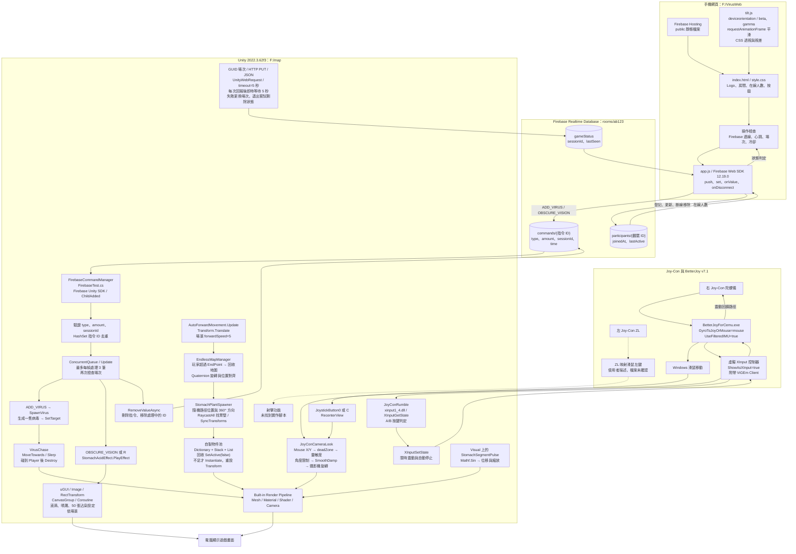

# Stomach Go 整合底層架構：依實際專案檔案

檢查日期：2026-10-14。資料來源：F:/map、F:/VirusWeb、F:/BetterJoy_v7.1。
以磁碟上的程式、BetterJoy 設定與 Build Settings 啟用場景為準；不代表已實機驗證全部鏈路。
此次沒有修改遊戲、網頁或 BetterJoy 設定。

## 必須修正前版圖的地方

- 已啟用的角色移動是 AutoForwardMovement（場景速度 5），不是換線或 WASD。
- PlayerController、FirstPersonLaneMovement、LanePathRunner 在目前場景停用。
- JoyConAimController.cs 的類別實際是 JoyConCameraLook；它旋轉攝影機，不直接移動 UI 準星。
- 未在專案 C# 找到 GetMouseButton、Fire1 或射擊處理；ZL→滑鼠左鍵是使用者描述，設定檔沒有足以驗證該映射的項目。
- 有啟用 JoyConRumble，讀取 XInput A／B 按鈕後送出震動，不是射擊程式。
- BetterJoy MotionServer 開啟，但 Unity 自訂程式未找到 UDP 客戶端，不能把 UDP 畫成遊戲實際使用的通道。
- 目前兩個已掛載的 StomachPlantSpawner 為 VillusSpawner_A（200）與 FoodresidueSpawner_A（50）；都共用物件池生成器。
- 網頁第一按鈕說明寫病毒移動速度提升，但實際指令 ADD_VIRUS 只新增一隻病毒。
- GIVE_HP 在 Unity 只有接收日誌與註解，沒有已完成補血功能。

## 整合架構圖

實線：程式或設定已有依據。虛線：使用者描述但尚未在專案檔案證實的操作。

## 指令與狀態約定

| 資料 | 內容 | 實際處理 |
|---|---|---|
| commands | type、amount、sessionId、time | 網頁以 push 建立 ID，以 set 寫入；time 為 serverTimestamp |
| ADD_VIRUS | amount=1 | Unity 一次產生一隻；病毒指令最低間隔設定 0.2 秒 |
| OBSCURE_VISION | amount=1 | 呼叫與 R 鍵共用的胃液特效，不代表 1 秒 |
| gameStatus | sessionId、lastSeen | Unity REST PUT；lastSeen 使用 Firebase .sv timestamp |
| participants | joinedAt、lastActive | 觀眾 ID 存於 localStorage，網頁監看並統計；斷線用 onDisconnect.remove |

網頁病毒冷卻 1.5 秒、胃液冷卻 5 秒；遊戲心跳有效期 15 秒，每秒刷新操作狀態。
觀眾閒置門檻為 10 分鐘，每 30 秒檢查。第三個按鈕未綁定指令。
發送成功代表資料庫寫入成功，目前沒有 Unity 執行完成 ACK 回傳。
Unity 沒有使用指令 time 做到期判定，舊指令防護依靠 sessionId。

## BetterJoy 設定與支援範圍

- mouse 模式、右手陀螺儀（GyroMouseLeftHanded=false）、X/Y 靈敏度 1200/800。
- UseFilteredIMU=true、AHRS_beta=0.05；此為設定值，未對執行檔反編譯確認內部算法。
- ShowAsXInput=true、ShowAsDS4=false、EnableRumble=true；資料夾包含 WindowsInput.dll、Nefarius.ViGEm.Client.dll。
- MotionServer=true、127.0.0.1:26760，但目前 Unity 腳本没有 UDP 接收程式。
- settings 中 reset_mouse=joy_10；Unity 的攝影機置中則讀 JoystickButton0/C，是兩個不同的置中機制。
- 未查到 ZL→滑鼠左鍵的可驗證設定，且 Unity 沒有找到射擊腳本，故以虛線標示。

## 場景核對

Build Settings 啟用 Assets/Scenes/throat to esophagus(level1).unity。
Player 上 AutoForwardMovement 啟用；PlayerController、FirstPersonLaneMovement、LanePathRunner 停用。
JoyConAimController 物件上 JoyConCameraLook 與 JoyConRumble 啟用。
FirebaseManager 綁定胃液效果元件。
Visual 上三個 StomachSegmentPulse 啟用；Segment_A/B/C 根物件上的同名元件停用。
StomachPeristalsisManager 指向根物件上停用的元件，因此不能確認其調整會作用於啟用的 Visual 蠕動。
Prefab、材質與 Shader 為渲染資源；沒有依據把 NavMesh、URP、HDRP 或射擊命中計算列為現有功能。

## 原始檔案索引

- [BetterJoy 設定](/F:/BetterJoy_v7.1/BetterJoyForCemu.exe.config:88)
- [BetterJoy 儲存設定](/F:/BetterJoy_v7.1/settings)
- [攝影機控制](/F:/map/Assets/script/JoyConAimController.cs:4)
- [XInput 震動回饋](/F:/map/Assets/script/JoyConRumble.cs:60)
- [自動前進](/F:/map/Assets/script/AutoForwardMovement.cs:3)
- [地圖循環](/F:/map/Assets/script/EndlessMapManager.cs:3)
- [生成器與物件池](/F:/map/Assets/script/StomachPlantSpawner.cs:79)
- [Firebase 指令與心跳](/F:/map/Assets/script/FirebaseTest.cs:175)
- [胃液效果](/F:/map/Assets/script/StomachAcidEffect.cs:82)
- [手機指令與在線判定](/F:/VirusWeb/public/app.js:572)
- [手機本機傾斜](/F:/VirusWeb/public/tilt.js:72)
